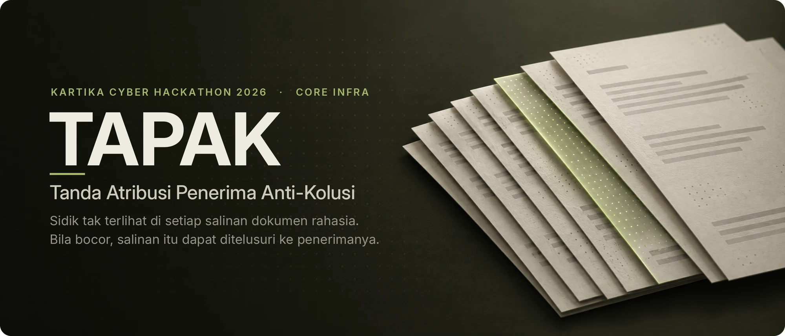
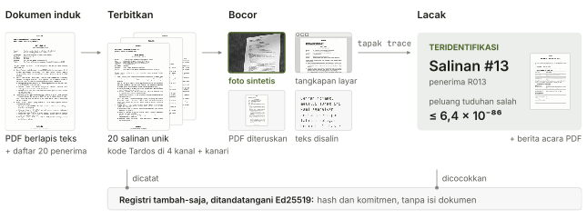
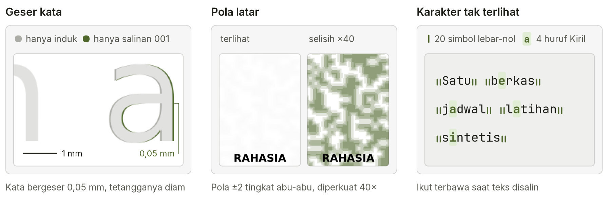
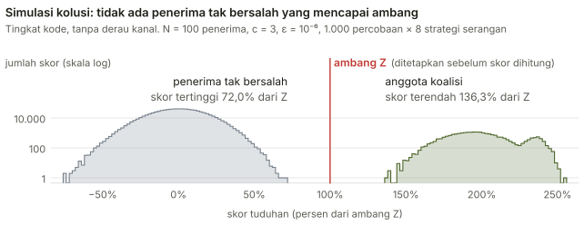
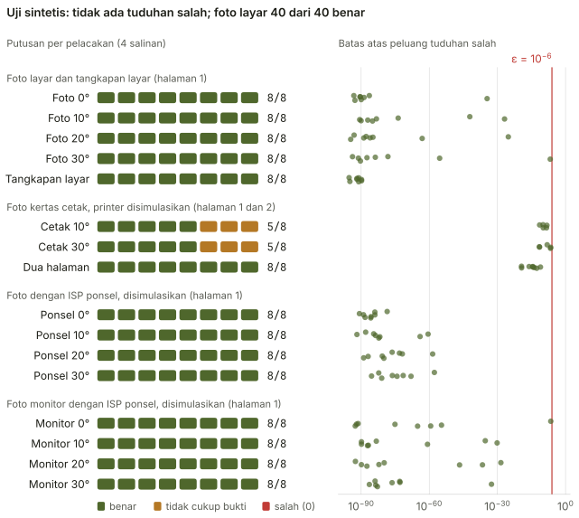
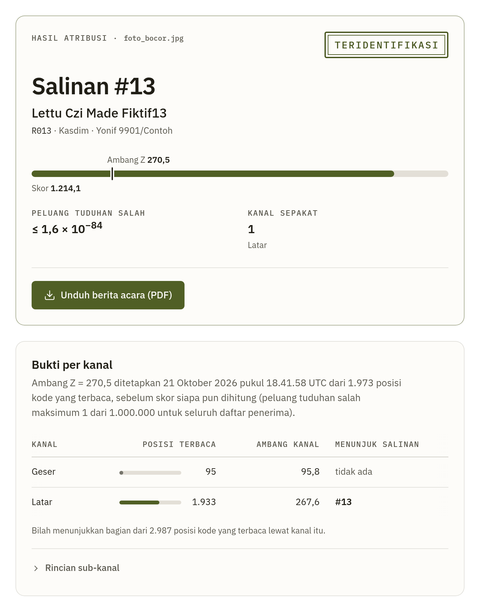

<p align="center">
  
</p>

<p align="center">
  <a href="README.md">Bahasa Indonesia</a> · <b>English</b><br>
  <a href="https://tapak.fly.dev/demo?lang=en">Live demo</a> ·
  <a href="#how-it-works">How it works</a> ·
  <a href="#results">Results</a> ·
  <a href="#quick-start">Quick start</a> ·
  <a href="docs/cara-kerja.md">Documentation (Indonesian)</a>
</p>

Every recipient of a classified document gets a copy that looks the same as everyone else's, but each carries its own fingerprint. When one copy leaks as a photo, a screenshot, a forwarded PDF or copied text, TAPAK points to the copy it came from and the recipient recorded for it, with an upper bound on the chance that the accusation is wrong. When the evidence falls short, TAPAK answers "not enough evidence" and names no one.

The fingerprint is a Tardos code. In code-level simulation, the merged codes of three colluding recipients still point to all three without dragging in anyone else. Everything runs on your own computer, with no cloud services. The documents and names in this repository are fictional.

## How it works

<picture>
  <source media="(prefers-color-scheme: dark)" srcset="docs/img/alur-dark.svg">
  
</picture>

1. **Issue.** TAPAK redraws the PDF for every recipient, puts that recipient's code into four channels, and adds a canary token.
2. **Trace.** The decoder reads whatever is left in the evidence, combines every channel, and compares each copy's score with a threshold. That threshold is fixed before any score is computed.
3. **Report.** A verdict that names someone always comes with its score, threshold and false-accusation bound, written up as a forensic report (berita acara) PDF.

### Five channels

<picture>
  <source media="(prefers-color-scheme: dark)" srcset="docs/img/kanal-dark.png">
  
</picture>

- **Word and line shifts** survive screenshots and photos of a screen. On real paper they are read with many errors and do not name a copy by themselves.
- **The background pattern** survives screenshots and photos of a screen. On paper the very faint default pattern depends on the printer: the one real printer tested printed it, and every photo of a printed copy was named through it. The optional print profile is read almost without errors on paper, at the price of pages that look light grey.
- **Invisible characters** travel with copied text and forwarded PDFs.
- **Sentence variants**, rewordings of opening and closing sentences made by a local LLM and approved by a person, survive retyping but carry only a few bits.
- **A DNS canary**, a unique subdomain per copy, goes off when the file is opened outside the unit's network. Canaries play no part in the score.

The decoder reads and combines the remaining evidence without looking at any recipient's code, so the false-accusation bound holds for any evidence, as long as the code secret is safe and the issuance record is intact.

## Results

<picture>
  <source media="(prefers-color-scheme: dark)" srcset="docs/img/skor-dark.svg">
  
</picture>

The threshold comes from a Chernoff bound, not from this simulation. Zero false accusations in 1,000 trials per strategy only shows that the rate is below about 3 &times; 10<sup>-3</sup>; the 10<sup>-6</sup> bound comes from the computation.

<picture>
  <source media="(prefers-color-scheme: dark)" srcset="docs/img/benchmark-dark.svg">
  
</picture>

The print row photographs pages from a simulated laser printer. That simulated printer drops the default background pattern, so only the shift channel is left. With shift scheme v2, the default for new issuances, page 1 names the right copy in 8 of 8 photos, the shorter page 2 in 2 of 8, and both pages together in 8 of 8 (scheme v1: 0 of 16 and 8 of 8). All of this is simulation, with one code secret and perfectly flat sheets. On real prints (one printer, 18 phone photos of three copies) every photo names the right copy, through the background pattern and not the shift channel ([limitation 3](docs/keamanan.md#batasan-3)).

One photo of a screen with 95 % of the paper saturated white loses its background pattern ([limitation 4](docs/keamanan.md#batasan-4)). That photo is named through the shift channel alone, just above the threshold (as the first recorded trace, with a smaller eps share, the answer is "not enough evidence"), and the threshold is not lowered. For the other 39 right answers on photos of a screen, the false-accusation bound is at most 6.3 &times; 10<sup>-26</sup>.

Other tests:

- A digital page merged from two copies (tested on 2 pairs): both recipients are accused, no one else.
- A simulated opening of a copy shows up in the canary log in about 0.1 seconds.
- Issuing 20 copies of a 2-page document takes 4 to 5 seconds on an idle test machine.

The full numbers, including noisy channels and coalitions of 5, are in [how it works](docs/cara-kerja.md#angka-simulasi) (Indonesian).

## Interface

<picture>
  <source media="(prefers-color-scheme: dark)" srcset="docs/img/ui-lacak-dark.png">
  
</picture>

The product page at `/` explains TAPAK for government agencies with numbers and charts from the result files in this repository. The guided **demo** at `/demo` issues a sample memo to 20 fictional recipients, lets you leak one copy (a phone photo, a screenshot, part of a page, the PDF, or its text), and traces it to a forensic report, in a separate workspace that does not touch your registry.

Every page is in Indonesian and English: the ID | EN switch sits in the navigation and the choice is kept in a cookie. The forensic report PDF follows the page language; the English one is a rendition, and the Indonesian form stays the official version.

The **Trace** page above reads the same photo as the flow figure. Here only the background pattern names copy #13 on its own (channels agreeing: 1), and that pattern is absent from photos of printed copies. The **Issue** page takes a PDF (with a text layer, or scanned) and a recipient list, offers a background profile (screen or print) and a shift scheme (v2 or v1), asks for a review of every variant and every word-choice point (optional), and produces a ZIP of copies.

## Quick start

You need Python 3.11 or newer and [uv](https://docs.astral.sh/uv/). On Ubuntu:

```bash
sudo apt-get install -y \
  tesseract-ocr tesseract-ocr-ind poppler-utils \
  libpango-1.0-0 libharfbuzz-subset0
make setup  # once, needs the network
make demo   # the whole scenario, about 30 seconds
make web    # product page at http://127.0.0.1:8000, guided demo at /demo
make test   # every test
```

Docker, every `tapak` command, keys and configuration are in the [operating guide](docs/operasi.md) (Indonesian).

## Security

- TAPAK contacts no outside service. The only part that faces the internet is the DNS canary listener.
- The registry is append-only, with a SHA-256 chain and Ed25519 signatures. It stores no document text, images or recipient names.
- With a public key installed, TAPAK names someone only when the registry chain is intact and every copy matches its entry. Entries not signed yet are clearly marked in the result. The standalone mode `tapak trace --master --manifest` skips these checks, says so in its output, and makes no forensic report.
- An optional anchor log reveals entries deleted from the end of the registry before the next trace or issuance, as long as it is kept where the people who can edit the registry cannot edit it.
- In Docker the canary listener runs in its own container and network, and sees only its own log and the list of valid tokens.

The details, including the registry format for auditors, are in [security](docs/keamanan.md) (Indonesian).

## Limitations

- **Prints** are traced through the background pattern; the shift channel alone is not enough on real paper (0 of 18 photos). On the one real printer tested, all three copies are named from every photo, also after a messaging app has shrunk it (36 of 36). The default profile's pattern printed there with a fifth of its bits wrong, the print profile's with 2 %; a printer that drops very light greys will lose the default pattern. For documents that will be printed, choose the print profile (the page looks light grey) ([limitation 3](docs/keamanan.md#batasan-3)).
- **Retyping** leaves only the sentence variants and the optional word choice. One- and two-page documents stay at "not enough evidence"; a single leaker can be named from about 1,300 content words (simulation), without collusion resistance. Word choices can be imitated, so a name backed only by word choice always carries a warning ([limitation 1](docs/keamanan.md#batasan-1)).
- **Canaries** go off only in viewers that fetch outside content, such as Adobe Reader and Word, and Adobe Reader first shows a permission warning that makes the canary easy to spot ([limitation 7](docs/keamanan.md#batasan-7)).
- **An adversary who understands TAPAK** can get away without a name and without a warning by scrambling or weakening the marks, even from a single copy. Reversed marks and erasures where the coalition's copies agree usually trigger a warning, except erasures on prints. No one else is accused because of them ([limitation 6](docs/keamanan.md#batasan-6)).
- **Most test photos and prints are synthetic.** From real devices there are 31 phone photos from one printer: 18 of prints of three copies (all named correctly) and 13 of prints of the unmarked master (nobody accused). Other printers, marked sheets that are crumpled or wet, and photos of a real monitor have not been tested. The demo's sentence variants come from a mock phrase table; a local 3 to 4B LLM on a CPU gave 4 bits from 24 generations on two sample documents ([limitations 2](docs/keamanan.md#batasan-2) and [10](docs/keamanan.md#batasan-10)).

We would rather answer "not enough evidence" than guess. All thirteen limitations, with a summary table and their numbers, are in [security](docs/keamanan.md#batasan) (Indonesian).

---

<sub>Made for Kartika Cyber Hackathon 2026, Core Infra category. Every sample page is marked "CONTOH SINTETIS - BUKAN DOKUMEN ASLI" (synthetic sample, not a real document). The DejaVu fonts for documents and forensic reports (Bitstream Vera license, `tapak/assets/fonts/LICENSE-DejaVu.txt`), the IBM Plex fonts for the interface (SIL OFL 1.1, `tapak/web/static/fonts/LICENSE-IBM-Plex.txt`) and HTMX 1.9.12 (BSD license, `tapak/web/static/`) are included in the repository. HEIC photos are read with pillow-heif (BSD), whose wheel bundles libheif and libde265 (LGPL) and x265 (GPL).</sub>
