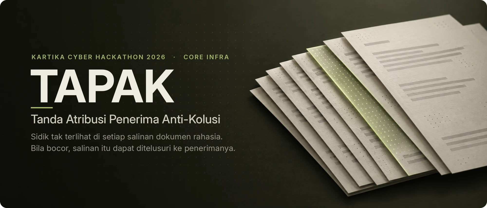
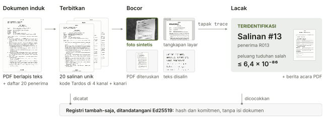
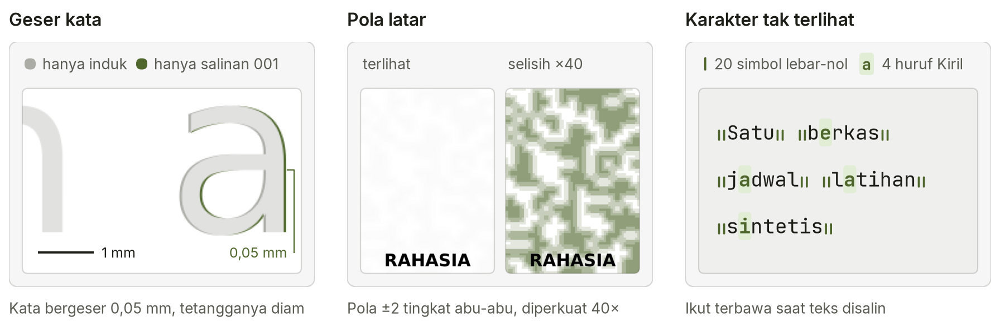
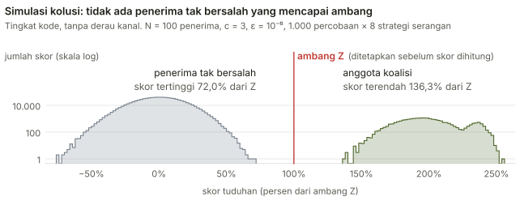
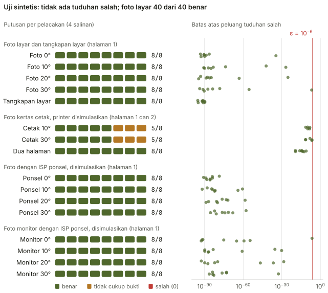
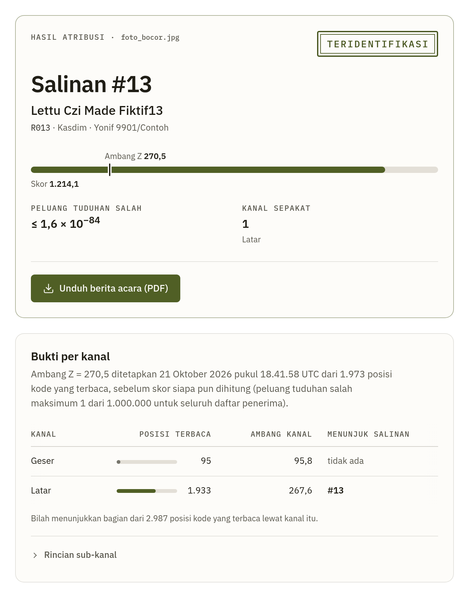

<p align="center">
  
</p>

<p align="center">
  <b>Bahasa Indonesia</b> · <a href="README.en.md">English</a><br>
  <a href="https://tapak.fly.dev/demo">Demo langsung</a> ·
  <a href="#cara-kerja">Cara kerja</a> ·
  <a href="#hasil">Hasil</a> ·
  <a href="#mulai-cepat">Mulai cepat</a> ·
  <a href="docs/cara-kerja.md">Dokumentasi</a>
</p>

Setiap penerima dokumen rahasia mendapat salinan yang tampak sama, tetapi masing-masing membawa sidiknya sendiri. Bila salah satu salinan bocor sebagai foto, tangkapan layar, PDF yang diteruskan, atau teks yang disalin, TAPAK menunjuk salinan sumbernya dan penerima yang tercatat untuk salinan itu, beserta batas atas peluang tuduhan salahnya. Bila buktinya kurang, TAPAK menjawab "tidak cukup bukti" dan tidak menyebut nama.

Sidiknya memakai kode Tardos. Dalam simulasi tingkat kode, gabungan kode tiga penerima yang bersekongkol tetap menunjuk ketiganya tanpa menyeret orang lain. Semua pemrosesan berjalan di komputer sendiri, tanpa layanan awan. Dokumen dan nama di repositori ini fiktif.

## Cara kerja

<picture>
  <source media="(prefers-color-scheme: dark)" srcset="docs/img/alur-dark.svg">
  
</picture>

1. **Terbitkan.** TAPAK menggambar ulang PDF untuk setiap penerima, menanam kode uniknya di empat kanal, dan menambahkan token kanari.
2. **Lacak.** Dekoder membaca apa pun yang tersisa di bukti, menggabungkan semua kanal, lalu membandingkan skor setiap salinan dengan ambang. Ambang itu ditetapkan sebelum skor dihitung.
3. **Laporkan.** Putusan yang menyebut nama selalu disertai skor, ambang, dan batas peluang tuduhan salah, lalu ditulis sebagai berita acara PDF.

### Lima kanal

<picture>
  <source media="(prefers-color-scheme: dark)" srcset="docs/img/kanal-dark.png">
  
</picture>

- **Geser kata dan baris** bertahan pada cetakan, foto, dan tangkapan layar.
- **Pola latar** bertahan pada foto layar dan tangkapan layar, tetapi hilang saat dicetak. Profil latar cetak (opsional) bertahan di kertas dalam uji printer simulasi, dengan harga halaman tampak abu-abu muda.
- **Karakter tak terlihat** ikut terbawa saat teks disalin atau PDF diteruskan.
- **Varian kalimat**, parafrasa kalimat pembuka dan penutup yang dibuat LLM lokal lalu disetujui manusia, bertahan saat dokumen diketik ulang, tetapi hanya membawa beberapa bit.
- **Kanari DNS**, subdomain unik per salinan, berbunyi bila berkas dibuka di luar jaringan satuan. Kanari tidak ikut dalam skor.

Dekoder membaca dan menggabungkan bukti yang tersisa tanpa melihat kode penerima, jadi batas peluang tuduhan salah berlaku untuk bukti apa pun, selama rahasia kode aman dan catatan penerbitan utuh.

## Hasil

<picture>
  <source media="(prefers-color-scheme: dark)" srcset="docs/img/skor-dark.svg">
  
</picture>

Ambangnya berasal dari batas Chernoff, bukan dari simulasi ini. Nol tuduhan salah dalam 1.000 percobaan per strategi hanya menunjukkan lajunya di bawah sekitar 3 &times; 10<sup>-3</sup>; batas 10<sup>-6</sup> datang dari perhitungannya.

<picture>
  <source media="(prefers-color-scheme: dark)" srcset="docs/img/benchmark-dark.svg">
  
</picture>

Baris cetak memotret halaman yang dicetak printer laser simulasi. Pola latar bawaan hilang di kertas, jadi hanya kanal geser yang tersisa. Dengan skema geser v2, bawaan penerbitan baru, halaman 1 menyebut salinan yang benar pada 8 dari 8 foto, halaman 2 yang lebih pendek pada 2 dari 8, dan kedua halaman bersama pada 8 dari 8 (skema v1: 0 dari 16 dan 8 dari 8). Semua ini memakai satu rahasia kode dan lembar yang datar sempurna. Dengan bentuk lembar kertas sungguhan, kanal geser tidak lagi menyebut siapa pun, sedangkan profil latar cetak tetap menyebut salinan yang benar ([batasan 3](docs/keamanan.md#batasan-3)).

Satu foto layar dengan 95 % kertas jenuh putih kehilangan pola latarnya ([batasan 4](docs/keamanan.md#batasan-4)). Foto itu disebut lewat kanal geser saja, tipis di atas ambang (sebagai pelacakan tercatat pertama, dengan jatah eps lebih kecil, jawabannya "tidak cukup bukti"), dan ambangnya tidak diturunkan. Untuk 39 jawaban benar lainnya pada foto layar, batas peluang tuduhan salahnya paling besar 6,3 &times; 10<sup>-26</sup>.

Uji lainnya:

- Halaman digital gabungan dua salinan (diuji pada 2 pasangan): kedua penerimanya dituduh, tidak ada orang lain.
- Pembukaan salinan yang disimulasikan tercatat di log kanari dalam sekitar 0,1 detik.
- Penerbitan 20 salinan dokumen 2 halaman selesai dalam 4 sampai 5 detik di mesin uji yang tidak sibuk.

Angka lengkap, termasuk kanal berderau dan koalisi 5 orang, ada di [cara kerja](docs/cara-kerja.md#angka-simulasi).

## Antarmuka

<picture>
  <source media="(prefers-color-scheme: dark)" srcset="docs/img/ui-lacak-dark.png">
  
</picture>

Halaman produk di `/` menjelaskan TAPAK untuk instansi pemerintah dengan angka dan grafik dari berkas hasil di repositori. **Demo** terpandu di `/demo` menerbitkan nota dinas contoh untuk 20 penerima fiktif, membocorkan satu salinan (foto ponsel, tangkapan layar, potongan halaman, PDF, atau teks), lalu melacaknya sampai berita acara, di ruang kerja terpisah yang tidak menyentuh registri Anda.

Semua halaman tersedia dalam bahasa Indonesia dan Inggris: pilihan ID | EN ada di navigasi dan diingat lewat cookie. Berita acara PDF mengikuti bahasa halaman; versi Inggrisnya terjemahan, dan yang resmi tetap versi Indonesia.

Halaman **Lacak** di atas membaca foto yang sama dengan gambar alur. Di sini hanya pola latar yang sendirian menunjuk salinan #13 (kanal sepakat: 1), dan pola itu tidak ada pada foto salinan yang dicetak. Halaman **Terbitkan** menerima PDF (berlapis teks atau hasil pindai) dan daftar penerima, menawarkan profil pola latar (layar atau cetak) dan skema geser (v2 atau v1), meminta peninjauan setiap varian dan setiap titik pilihan kata (opsional), lalu menghasilkan ZIP salinan.

## Mulai cepat

Butuh Python 3.11 atau lebih baru dan [uv](https://docs.astral.sh/uv/). Di Ubuntu:

```bash
sudo apt-get install -y \
  tesseract-ocr tesseract-ocr-ind poppler-utils \
  libpango-1.0-0 libharfbuzz-subset0
make setup  # sekali, perlu jaringan
make demo   # skenario lengkap, sekitar 30 detik
make web    # halaman produk http://127.0.0.1:8000, demo terpandu di /demo
make test   # seluruh pengujian
```

Docker, semua perintah `tapak`, kunci, dan konfigurasi ada di [panduan menjalankan TAPAK](docs/operasi.md).

## Keamanan

- TAPAK tidak menghubungi layanan luar. Satu-satunya bagian yang menghadap internet adalah pendengar DNS kanari.
- Registri bersifat tambah-saja, dengan rantai SHA-256 dan tanda tangan Ed25519. Registri tidak menyimpan teks dokumen, gambar, atau nama penerima.
- Bila kunci publik terpasang, TAPAK hanya menyebut nama kalau rantai registri utuh dan setiap salinan cocok dengan entrinya. Entri yang belum bertanda tangan ditandai jelas di hasil. Mode lepas `tapak trace --master --manifest` melewati pemeriksaan ini, menyatakannya di keluaran, dan tidak membuat berita acara.
- Log jangkar opsional mengungkap entri yang dihapus dari ujung registri sebelum pelacakan atau penerbitan berikutnya, asalkan log itu disimpan di tempat yang tidak dapat disunting orang yang dapat menyunting registri.
- Di Docker, pendengar kanari berjalan di kontainer dan jaringan terpisah, dan hanya melihat log-nya sendiri serta daftar token yang sah.

Rinciannya, termasuk format registri untuk auditor, ada di [keamanan](docs/keamanan.md).

## Batasan

- **Cetakan** dengan penerbitan bawaan hanya membawa kanal geser, karena pola latar bawaan hilang di kertas, dan kanal geser hanya terbaca dari lembar yang datar sempurna: satu halaman teks penuh menyebut nama pada semua foto simulasi 4000 px, tetapi pada 0 dari 16 foto bila bentuk lembar kertas sungguhan dipasang pada simulasi itu. Profil latar cetak (opsional, halaman tampak abu-abu muda) menyebut 16 dari 16; apakah printer sungguhan mencetak polanya belum diukur. Untuk dokumen yang akan dicetak, pilih profil cetak ([batasan 3](docs/keamanan.md#batasan-3)).
- **Ketikan ulang** hanya menyisakan varian kalimat dan pilihan kata opsional. Dokumen 1 sampai 2 halaman tetap "tidak cukup bukti"; satu pembocor baru dapat disebut dari sekitar 1.300 kata isi (simulasi), tanpa ketahanan kolusi. Pilihan kata dapat ditiru, jadi nama yang hanya didukung pilihan kata selalu diberi peringatan ([batasan 1](docs/keamanan.md#batasan-1)).
- **Kanari** hanya berbunyi di penampil yang mengambil konten luar, seperti Adobe Reader dan Word, dan Adobe Reader lebih dulu menampilkan peringatan izin yang membuat kanari mudah dikenali ([batasan 7](docs/keamanan.md#batasan-7)).
- **Lawan yang memahami TAPAK** dapat lolos tanpa nama dan tanpa peringatan dengan mengacak atau melemahkan tanda, juga dari satu salinan saja. Tanda yang dibalik dan penghapusan di tempat salinan koalisi sama umumnya diberi peringatan, kecuali penghapusan pada cetakan. Tidak ada orang lain yang tertuduh karenanya ([batasan 6](docs/keamanan.md#batasan-6)).
- **Hampir semua foto dan cetakan uji sintetis.** Dari perangkat sungguhan baru ada 13 foto ponsel dari cetakan dokumen induk tanpa tanda: 11 halamannya ditemukan dan tidak ada yang tertuduh. Apakah salinan yang benar disebut dari cetakan sungguhan belum terukur, dan cetakan tanpa tanda itu sudah menggeser kata sebesar tanda geser v2, jadi tanda itu kemungkinan besar tidak terbaca dari satu lembar cetak. Monitor sungguhan belum diuji. Varian kalimat di demo berasal dari tabel frasa tiruan; LLM lokal 3 sampai 4B di CPU memberi 4 bit dari 24 pembangkitan pada dua dokumen contoh ([batasan 2](docs/keamanan.md#batasan-2) dan [10](docs/keamanan.md#batasan-10)).

Kami memilih menjawab "tidak cukup bukti" daripada menebak. Ketiga belas batasan, dengan tabel ringkas dan angkanya, ada di [keamanan](docs/keamanan.md#batasan).

---

<sub>Dibuat untuk Kartika Cyber Hackathon 2026, kategori Core Infra. Setiap halaman contoh bertanda "CONTOH SINTETIS - BUKAN DOKUMEN ASLI". Font DejaVu untuk dokumen dan berita acara (lisensi Bitstream Vera, `tapak/assets/fonts/LICENSE-DejaVu.txt`), font IBM Plex untuk antarmuka (SIL OFL 1.1, `tapak/web/static/fonts/LICENSE-IBM-Plex.txt`), dan HTMX 1.9.12 (lisensi BSD, `tapak/web/static/`) disertakan di repositori. Foto HEIC dibaca dengan pillow-heif (BSD), yang rodanya memuat libheif dan libde265 (LGPL) serta x265 (GPL).</sub>
