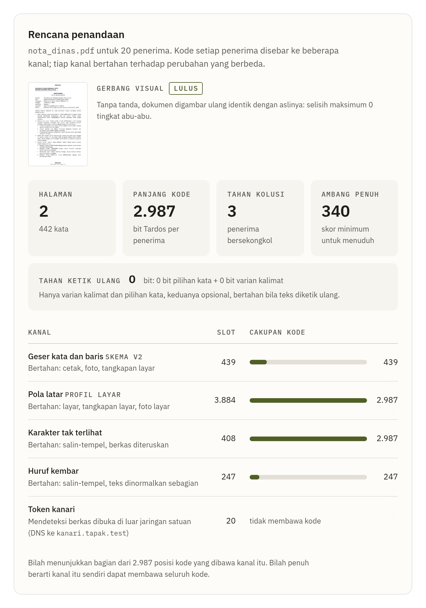

# Menjalankan TAPAK

[Kembali ke README](../README.md) · [Cara kerja](cara-kerja.md) · [Keamanan dan batasan](keamanan.md)

## Prasyarat

Python 3.11 atau lebih baru, `uv` (atau pip), Tesseract dengan bahasa Indonesia, poppler-utils, dan pango (untuk WeasyPrint). Di Ubuntu:

```bash
sudo apt-get install -y tesseract-ocr tesseract-ocr-ind poppler-utils libpango-1.0-0 libharfbuzz-subset0
make setup          # memasang dependensi (sekali, perlu jaringan)
make demo           # skenario lengkap tanpa interaksi
make test           # seluruh pengujian
make simulate       # angka simulasi Tardos
make photos bench   # kumpulan foto sintetis lalu uji regresi dekoder
make photos-cetak   # foto kertas cetak (printer disimulasikan); make bench melaporkannya terpisah
make photos-ponsel  # foto make photos lewat ISP ponsel simulasi; dilaporkan terpisah
make photos-layar   # foto salinan di monitor simulasi (subpiksel, moire) dengan ISP ponsel; dilaporkan terpisah
make bench-check    # semua kumpulan foto dari awal; hasilnya harus sama byte demi byte dengan docs/results
make web            # antarmuka web di http://127.0.0.1:8000
make figures        # grafik README dibuat ulang dari kode dan data (perlu: uv pip install -e ".[figures]")
make docker-cek     # image Docker diuji ujung ke ujung dengan tag, nama proyek, dan port sendiri (lihat Docker)
make kunci-versi    # versi pustaka Python image (requirements.lock) dari .venv yang sudah diuji (lihat Docker)
```

Tesseract dengan bahasa Indonesia (dan Inggris, yang ikut terpasang bersama `tesseract-ocr`) juga dipakai saat melacak bukti gambar dokumen yang memakai varian kalimat atau pilihan kata: setiap halaman yang ditemukan pada foto, tangkapan layar, pindaian, atau foto cetakan dibaca dengan OCR lokal, satu utas, sekitar 3 detik per halaman di mesin uji yang dipakai bersama (median 2,9 detik; foto 4000 px sekitar 4 detik, paling lama 10 detik), di atas waktu pelacakan foto biasa ([cara kerja](cara-kerja.md#teks-terlihat-pada-bukti-gambar-ocr)). Tanpa Tesseract atau data bahasa Indonesianya, pelacakan tetap berjalan tanpa kedua kanal itu, dan hasilnya menyebutnya dalam satu baris catatan. Dokumen tanpa kedua kanal itu tidak memakai OCR saat pelacakan, kecuali sebagai cadangan registrasi bila tepi halaman dan fitur gambar tidak ditemukan.

Setelah `make setup`, semuanya berjalan luring. Tangkapan layar antarmuka di README dibuat terpisah dengan `docs/figures/shoot_ui.py` (perlu Playwright dan Chromium). Tanpa `TAPAK_FIG_FONTS` (Inter dan JetBrains Mono), grafik memakai DejaVu.

## Baris perintah

```bash
tapak keys init                                  # rahasia kode + kunci tanda tangan registri
tapak issue samples/nota_dinas.pdf samples/recipients.csv --canary-domain kanari.satuan.mil
tapak issue dok.pdf penerima.csv --latar cetak   # pola latar yang bertahan saat dicetak (lihat di bawah)
TAPAK_WORKERS=2 tapak issue dok.pdf penerima.csv # paling banyak 2 proses kerja (bawaan: sebanyak CPU, paling banyak 8)
tapak issue dok.pdf penerima.csv --geser v1      # skema geser lama (bawaan: v2)
tapak docs                                       # daftar dokumen terbitan
tapak trace foto_bocor.jpg --doc <hash> --report berita_acara.pdf
tapak trace foto_hal1.jpg foto_hal2.jpg --doc <hash>      # beberapa bukti satu kebocoran, digabung
tapak trace foto_bocor.jpg --master induk.pdf --manifest manifest.json --pelacakan-ke 2 --bertahap bertahap-v1   # ulangi pelacakan ke-2 (perintah di berita acara)
tapak verify                                     # verifikasi registri dengan kunci publik saja
tapak verify --jangkar 63:<hash>                 # juga mendeteksi entri yang dihapus setelah jangkar itu
tapak --log-jangkar /mnt/jangkar/tapak.log jangkar mulai   # log jangkar eksternal (opsional, lihat di bawah)
tapak jangkar status                             # bandingkan log jangkar dengan registri, ukuran, dapat ditulis
tapak jangkar rotasi /mnt/jangkar/tapak-2.log    # teruskan log ke segmen baru sebelum batas ukurannya
tapak registry export-merkle                     # akar Merkle harian
tapak semantic suggest dok.pdf -o varian.json    # usulan varian oleh LLM lokal
tapak semantic approve varian.json --unit u0 --variant 2   # keputusan manusia
tapak issue dok.pdf penerima.csv --semantic varian.json    # ditolak jika masih ada varian menunggu
tapak leksikal scan dok.pdf -o leksikal.json     # titik pilihan kata (opsional), semua menunggu tinjauan
tapak leksikal show leksikal.json                # konteks, bentuk, status, jumlah bit
tapak leksikal review leksikal.json --interaktif # putuskan titik satu per satu
tapak issue dok.pdf penerima.csv --leksikal leksikal.json  # ditolak jika masih ada titik menunggu
tapak simulate --n 100 --c 3 --eps 1e-6 --trials 1000
tapak simulate --table
tapak simulate --n 100 --c 3 --coalition 5 --bertahap   # tuduhan satu tahap dan pelacakan bertahap pada bocoran yang sama
tapak deteksi --n 20 --c 3 --ber 0.05            # batas terbukti peluang koalisi lolos dengan 5 % bit salah
tapak deteksi --sebaran research/deteksi/hasil/llr_foto.json --target 1e-6   # bobot dekoder pada foto sintetis
tapak canary-dns --domain kanari.satuan.mil --port 53   # log di data/kanari/, daftar izin di data/kanari-izin/
tapak kanari-izin                                # tulis ulang daftar izin token dari semua penerbitan
```

`--latar` memilih profil pola latar. `layar` (bawaan) tidak terlihat, tetapi hilang saat dokumen dicetak. `cetak` bertahan pada kertas cetak (diuji dengan printer simulasi), tetapi seluruh halaman tampak abu-abu muda dan teksturnya mungkin terlihat, sehingga TAPAK mencetak peringatan. Pakai `cetak` hanya untuk dokumen yang memang akan dicetak dan bila tampilan itu diterima ([cara kerja](cara-kerja.md#salinan-yang-dicetak)). Di antarmuka web pilihan yang sama ada di langkah pertama Terbitkan (Pola latar, bawaan Layar); bila Cetak dipilih, peringatan itu tampil di formulir, di rencana penandaan, dan di hasil penerbitan.

`--geser` memilih skema geser kata. `v2` (bawaan) menggeser setiap kelompok kata 0,025 mm dan membaca lebih dari dua kali jumlah posisi per halaman `v1`, sehingga foto salinan cetak yang tajam sering cukup dari satu halaman penuh teks dalam uji printer simulasi (benchmark README: halaman 1 pada 8 dari 8 foto, halaman 2 yang lebih pendek pada 1 dari 8; angkanya bergantung pada rahasia kode, [batasan 3](keamanan.md#batasan), dan [cara kerja](cara-kerja.md#skema-geser-v2)). `v1` adalah skema semua dokumen yang terbit sebelumnya; catatan penerbitannya tidak menyebut skema dan tetap dibaca seperti dulu. Catatan penerbitan dan registri dokumen v2 hanya menyimpan nama skemanya. Di antarmuka web pilihan yang sama ada di langkah pertama Terbitkan (Skema geser kata, bawaan v2).

Pelacakan foto atau pindaian pertama untuk setiap halaman dan resolusi analisis merender templat induk tepat untuk kanal geser, sekitar 5 sampai 7 detik CPU per halaman penuh teks. `tapak web` menyimpannya di memori untuk pelacakan berikutnya, sedangkan setiap perintah `tapak trace` merendernya lagi.

Port 53 harus bebas di komputer pendengar. Di banyak distro Linux, `systemd-resolved` sudah memakai 127.0.0.53:53. Ikat pendengar ke alamat publik, atau jalankan di port lain lalu teruskan port 53 ke sana seperti di Docker.

Pihak ketiga cukup memegang berkas registri dan kunci publik:

```bash
tapak-verify-registry data/registry.db --public-key keys/registry_signing.pub
tapak-verify-registry data/registry.db --public-key keys/registry_signing.pub --log-jangkar tapak.log   # dengan log jangkar
```

Kode keluar: 0 utuh, 1 ada masalah, 3 utuh sejauh yang diperiksa tetapi registri memakai log jangkar yang tidak diberikan. Kode 3 berarti entri yang dihapus dari ujung rantai belum diperiksa; minta log jangkarnya. Bila log pernah dirotasi, minta juga segmen lamanya (`--segmen-lama`); tanpa itu hasilnya tetap 0 dengan peringatan bahwa rotasi tidak diperiksa.

## Log jangkar eksternal (opsional)

Tanpa log jangkar, entri pelacakan yang dihapus dari ujung registri dengan menyunting berkasnya di luar TAPAK hanya terungkap oleh jangkar di berita acara atau akar Merkle yang disimpan di luar sistem ([batasan 13](keamanan.md#batasan)). Log jangkar membuat penghapusan itu terdeteksi otomatis: setelah setiap entri registri tersimpan, TAPAK menambahkan satu baris (nomor, hash, jenis, waktu entri) ke berkas di penyimpanan terpisah, dan sebelum setiap pelacakan dan penerbitan membandingkan registri dengan berkas itu. Bila tidak diatur, perilaku TAPAK tidak berubah; hasil pelacakan hanya mendapat satu baris yang menyebut bahwa penghapusan itu belum terperiksa.

**Di mana menyimpannya.** Log hanya melindungi bila orang yang dapat menyunting `registry.db` tidak dapat menyunting log itu. Berkas di komputer dan akun yang sama tidak melindungi apa pun, dan TAPAK memperingatkan bila log berada di folder data atau kunci. Pilihan, dari yang paling sederhana:

* berkas di komputer yang sama yang diberi atribut tambah-saja oleh root (`sudo chattr +a`), sehingga akun TAPAK hanya dapat menambah baris. Ini melindungi dari pengguna biasa yang dapat menyunting registri, tetapi tidak dari root;
* media tulis-sekali (WORM) yang dipasang sebagai folder;
* folder di komputer kedua yang dipasang lewat sistem operasi (misalnya berbagi jaringan yang dikelola admin lain, tempat akun TAPAK hanya dapat menambah). TAPAK tidak menjalankan layanan jaringan untuk ini; penyimpanannya harus mendukung kunci berkas (`flock`).

**Memasang.**

```bash
sudo mkdir -p /mnt/jangkar && sudo chown tapak /mnt/jangkar     # atau pasang penyimpanan terpisahnya di sini
export TAPAK_ANCHOR_LOG=/mnt/jangkar/tapak.log                  # atau: tapak --log-jangkar /mnt/jangkar/tapak.log ...
tapak verify                                                     # registri harus utuh dulu
tapak jangkar mulai                                              # baris awal, lalu semua entri yang sudah ada
sudo chattr +a /mnt/jangkar/tapak.log                            # bila memakai atribut tambah-saja
tapak jangkar status                                             # cocok dengan registri sampai entri #N
```

TAPAK tidak pernah membuat folder log, agar log tidak diam-diam tertulis di disk lokal ketika penyimpanan terpisah belum dipasang. `tapak jangkar mulai` mencatat awal log di registri (entri `anchor_log`) dan menulis penanda media (lihat di bawah). Sejak itu semua proses yang menulis registri ini, yaitu CLI, `tapak web`, dan kontainer `app`, harus memakai log yang sama; proses tanpa log menolak pelacakan dan penerbitan. Log dikenali dari isinya, bukan dari jalurnya, jadi host dan kontainer boleh menyebut berkas yang sama dengan jalur berbeda. Antarmuka web tidak memiliki halaman pengaturan: jalankan `tapak --log-jangkar /mnt/jangkar/tapak.log web` atau atur variabelnya sebelum server dijalankan. Halaman Registri menampilkan keadaan log, dan hasil Lacak memuat satu baris tentangnya. Di Docker, pakai `docker-compose.jangkar.yml` ([Docker](#log-jangkar-di-docker)).

**Penanda media.** Bila penyimpanan terpisah belum dipasang, titik kaitnya hanya folder kosong di disk lokal. Karena itu `tapak jangkar mulai` menulis penanda `.tapak-jangkar-media` di samping log (id-nya tercatat di baris awal log), dan setiap pemeriksaan menolak log tanpa penanda itu. `mulai --ulang` dan `rotasi` hanya membuat log di folder yang sudah bertanda; untuk media baru, atau log dari sebelum ada penanda, tambahkan `--tandai-media`. Perintah itu juga mencetak catatan bila folder log bukan titik kait. Pindahkan penanda bersama log.

**Yang terlihat.** Hasil pelacakan, keluaran CLI, dan berita acara memuat satu baris, misalnya "Log jangkar: cocok dengan registri sampai entri #8; entri baru #8 dicatat di log". `tapak jangkar status` juga menyebut ukuran log dan apakah log dapat ditulis; log yang tidak dapat ditulis menolak pelacakan dan penerbitan, jadi status keluar dengan kode 1. `tapak verify` dan `tapak-verify-registry --log-jangkar` mencocokkan log tanpa mengubah apa pun dan tanpa izin tulis. Jangkar berita acara (`tapak verify --jangkar`) tetap berguna sebagai cadangan manual, misalnya untuk dicatat di luar sistem bersama berkas perkara.

**Ukuran dan rotasi.** Log di atas 256 MiB (sekitar 700.000 baris) tidak dibaca lagi, dan semua pelacakan dan penerbitan ditolak; mulai 192 MiB setiap pemeriksaan memperingatkannya. Sebelum itu, misalnya setahun sekali, teruskan log ke segmen baru:

```bash
tapak jangkar rotasi /mnt/jangkar/tapak-2026.log --alasan "rotasi tahunan"
export TAPAK_ANCHOR_LOG=/mnt/jangkar/tapak-2026.log            # di semua proses: CLI, tapak web, kontainer app
tapak verify --segmen-lama /mnt/jangkar/tapak.log               # rantai segmen tetap dapat diperiksa
```

Halaman Registri menandai log di atas batas "Terlalu besar" (bukan "Hilang") dengan perintah rotasinya, `tapak jangkar status` menyebut "TERLALU BESAR" beserta ukurannya, dan `tapak verify` juga menyebut "TERLALU BESAR". Rotasi hanya berjalan bila log lama cocok dengan registri. Segmen baru dimulai dengan baris yang mengikat log lama (id, panjang, SHA-256, ujung registri yang dijangkarkannya, pengakuan yang berlaku) dan baris yang menjangkarkan ujung itu lagi; registri mencatatnya (entri `rotate`). Simpan segmen lama (boleh dijadikan hanya-baca). Proses yang masih memakainya ditolak dan diminta menjalankan `tapak verify --log-jangkar SEGMEN_BARU --segmen-lama SEGMEN_LAMA` sebelum pindah, karena hanya segmen lama yang membuktikan bahwa rotasi tidak dipalsukan untuk menyembunyikan penghapusan. Setiap hasil sesudahnya menyebut rotasi itu. Rotasi juga cara pindah lokasi tanpa awal ulang, dan masih dapat membaca log sampai 512 MiB. Jangan menunggu sampai batas: `mulai --ulang` menulis satu baris per entri registri, jadi pada registri sebesar itu log barunya langsung melewati batas. Batasnya tidak dinaikkan karena pemeriksaan pertama setiap proses tetap membaca seluruh segmen.

**Kecepatan.** Dalam satu proses, pemeriksaan berikutnya hanya mengurai dan memverifikasi baris baru dan tidak menghitung ulang hash entri registri yang tidak berubah; hasil lama hanya dipakai bila byte log yang sudah diperiksa masih sama (SHA-256). Pada log 100.000 baris (35 MiB) satu penulisan turun dari sekitar 26 menjadi sekitar 1,5 detik di `tapak web` (mesin bersama yang sibuk, `scripts/bench_jangkar.py`). Perintah CLI tetap memeriksa penuh sekali, sekitar 26 detik pada ukuran itu.

**Bila proses mati.** Baris ditulis setelah entri tersimpan. Bila proses mati di antaranya, log tertinggal satu entri, dan penulisan berikutnya melengkapinya otomatis. Log yang tidak dapat ditulis (misalnya penyimpanan hanya-baca) ditolak sebelum entri baru dicatat. Pelacakan yang barisnya tetap gagal ditulis setelah entrinya tersimpan dibatalkan sebelum bukti dibaca, dan nomornya tetap terpakai. Baris yang terpotong karena mati listrik diabaikan dengan peringatan. `tapak jangkar mulai` yang terputus diselesaikan dengan menjalankan perintah yang sama lagi.

**Bila pelacakan ditolak.** Pesannya menyebut entri yang hilang, diganti, atau diubah. Jalankan `tapak verify` untuk rinciannya, lalu:

1. **Log hilang atau tidak terbaca.** Pasang kembali penyimpanannya atau perbaiki izinnya. Jangan menghapus atau mengganti log. Bila log memang hilang, periksa dulu registri dengan jangkar dari berita acara (`tapak verify --jangkar`) atau akar Merkle, lalu mulai log baru secara sadar: `tapak jangkar mulai --ulang --alasan "media jangkar rusak, diperiksa Kasi Ops"`. Awal yang baru tercatat di registri (`restart`) dan alasannya di baris pertama log baru. Log lama yang dipasang kembali sesudahnya ditolak karena sudah diganti, dan setiap hasil pelacakan dan `tapak verify` sesudahnya menyebut awal ulang ini. Bila pesan menyebut log sudah diganti log lain padahal tidak ada yang sengaja memulai ulang, jangan pindah ke log baru itu: periksa registri dengan log lama.
2. **Entri hilang atau diganti.** Kembalikan registri dari cadangan yang masih memuat entri itu; pemeriksaan berikutnya lulus sendiri. Bila entri itu memang tidak dapat dikembalikan, jalankan `tapak jangkar akui --alasan "..."` untuk melihat entri yang akan dilepas, lalu ulangi dengan `--ya`. Pengakuan tercatat di registri (`ack`) dan di log, dan setiap hasil pelacakan sesudahnya menyebutnya. Nomor dan jatah eps pelacakan yang hilang dapat terpakai lagi, jadi batas tuduhan salah gabungan dokumen itu tidak lagi terjamin.
3. **Entri diubah, rantai rusak, atau baris log dipalsukan.** Pengakuan tidak dapat melepasnya. Kembalikan registri atau log dari cadangan dan periksa siapa yang mengubahnya.

Alasan disimpan sebagai teks di log jangkar dan sebagai hash di registri; jangan menulis isi dokumen atau nama penerima di dalamnya. Belum ada perintah untuk berhenti memakai log jangkar pada registri yang sudah memakainya; untuk pindah lokasi, pakai `tapak jangkar rotasi`.

## Kanal pilihan kata (opsional)

Kanal ini hanya untuk dokumen induk PDF dan hanya aktif bila penerbit memberikan `--leksikal` (atau memindai titiknya di halaman Terbitkan, lihat [antarmuka web](#antarmuka-web)). Tanpa itu, penerbitan sama persis dengan sebelumnya.

1. **Pindai.** `tapak leksikal scan dok.pdf -o leksikal.json` mencari titik dengan tabel leksikon draf (`tapak/assets/leksikon/naskah_dinas_v1.json`; `--tingkat AB` ikut memakai kata isi tingkat B). Keluarannya menyebut jumlah titik dan bit, penolakan per kategori, dan perkiraan apakah dokumen cukup panjang untuk satu pembocor.
2. **Tinjau.** `tapak leksikal show leksikal.json` menampilkan setiap titik dengan seluruh kalimatnya (lintas baris), frasa dalam kurung siku, semua bentuknya, dan catatan aturannya (`--status menunggu` hanya menampilkan yang belum diputuskan). Titik bertanda "konteks berulang" memiliki frasa dan konteks yang sama di bagian lain dokumen; tolak titik itu bila bocoran dapat menukar urutan kalimat. Putuskan dengan salah satu cara berikut:
   * satu per satu: `tapak leksikal review leksikal.json --interaktif` (s = setujui, t = tolak, l = lewati, q = selesai);
   * per titik: `--titik l0,l3 --setujui`, `--titik l5 --tolak`, atau `--tunda` untuk mengembalikan ke status menunggu;
   * per aturan: `--aturan dan --tolak`. Persetujuan sekaligus per aturan atau `--semua` memerlukan `--ya`, setelah setiap titiknya dibaca.
3. **Terbitkan.** `tapak issue dok.pdf penerima.csv --leksikal leksikal.json` (boleh bersama `--semantic`). Penerbitan ditolak bila masih ada titik menunggu, bila titik atau bentuknya disunting di luar TAPAK, bila tabel leksikon berubah sejak pemindaian, atau bila pita bias 0,3 sampai 0,7 tidak cukup untuk semua bit (tolak sebagian titik atau pakai c lebih besar). Keluarannya menyebut jumlah bit tahan ketik ulang (pilihan kata dan semantik) dan jumlah kata isi. "Cukup untuk satu pembocor" baru muncul pada 64 bit atau lebih; di bawahnya keluaran menyebut kekurangan bit dan perkiraan kata isi tambahan.
4. **Simpan.** `leksikal.json` memuat teks dokumen. TAPAK menyimpannya di folder dokumen, di samping `induk.pdf` dan `varian.json`; registri hanya menyimpan digest-nya. Keputusan setuju atau tolak di berkas ini tidak diautentikasi, jadi simpan berkas itu di tempat yang hanya dapat ditulis penerbit, sebelum dan sesudah penerbitan. Saat pelacakan, berkas ini dicocokkan dengan digest di catatan penerbitan. Bila hilang atau tidak cocok, kanal pilihan kata dilewati dengan peringatan, dan kanal lain tetap dibaca.
5. **Baca hasilnya dengan hati-hati.** Nama yang hanya didukung pilihan kata dan varian kalimat diberi peringatan di bawah putusan: siapa pun yang pernah membaca salinan itu dapat meniru pilihan katanya. Nama seperti itu memerlukan bukti pendukung.
6. **Bukti gambar.** Pilihan kata dan varian kalimat pada foto, tangkapan layar, dan foto cetakan dibaca dengan OCR lokal (perlu Tesseract, lihat [prasyarat](#prasyarat)). Hasil CLI, JSON, halaman Lacak, dan berita acara menulis kanal itu dengan keterangan "OCR gambar", tanpa teks OCR-nya. Baris yang memuat titik pilihan kata keluar dari kanal geser, jadi untuk salinan yang akan dicetak kanal ini mengurangi lebih banyak posisi geser daripada yang dikembalikan OCR ([batasan 3](keamanan.md#batasan)).

## Dokumen induk hasil pindai

PDF hasil pindai diterbitkan dengan perintah yang sama, tanpa opsi tambahan:

```bash
tapak issue nota_pindaian.pdf penerima.csv
make samples-pindaian        # contoh fiktif 300 dpi di samples/generated/ (tidak di-commit)
```

* **Resolusi.** Setiap halaman pindaian minimal 200 dpi; 300 dpi disarankan. Di bawah itu penerbitan ditolak dengan pesan yang menyebut halaman dan resolusinya. Geser 0,05 mm (skema v1) tinggal 0,4 piksel pada 200 dpi dan 0,3 piksel pada 150 dpi, geser kata 0,025 mm skema v2 separuhnya, galat bit geser pada foto naik saat resolusi turun, dan Tesseract dibuat untuk sekitar 300 dpi ([batasan 8](keamanan.md#batasan)).
* **Yang ditolak.** Halaman pindaian yang diputar (`/Rotate`), gambar dengan masker (transparansi atau warna) atau konten opsional, dan satu gambar yang dipakai di beberapa halaman belum didukung. Halaman yang memuat teks terlihat di atas gambar diperlakukan sebagai halaman teks: hanya teks itu yang ditandai. Bila halaman itu juga berlapis OCR tak terlihat, kata OCR ikut tergambar ulang dan gerbang visual menolak penerbitan. Halaman yang tersusun dari beberapa gambar (misalnya kompresi MRC: latar dan masker teks terpisah) tidak dikenali sebagai halaman pindaian: tanpa lapisan teks halaman itu tidak membawa tanda, dan dengan lapisan OCR penerbitan ditolak.
* **Tesseract.** `tesseract-ocr` dan `tesseract-ocr-ind` diperlukan saat menerbitkan dan saat melacak, dengan versi yang sama. Pelacakan membaca ulang kotak kata (beberapa detik per halaman). Bila hasilnya berbeda dari saat penerbitan, kanal geser halaman pindaian dilewati dengan catatan, dan pola latar tetap dibaca. Simpan versi Tesseract bersama instalasi TAPAK.
* **Keluaran.** Rencana penandaan menyebut mode setiap halaman (teks atau pindaian), kanal yang berlaku, dan lapisan OCR yang dibuang. Gerbang menyatakan bahwa salinan tanpa tanda identik piksel demi piksel dengan induk. Gambar halaman salinan disimpan tanpa kompresi lossy, jadi salinan jauh lebih besar dari induk JPEG-nya (contoh 300 dpi: sekitar 2,9 MB per halaman, induk 0,7 MB per halaman). Ukuran rata-rata dan terbesar dicetak setelah penerbitan.
* **Antarmuka web.** Halaman Terbitkan menerima induk hasil pindai dan dokumen campuran. Kotak kata dibaca dengan Tesseract saat analisis, beberapa detik per halaman. Rencananya menyebut mode setiap halaman, jumlah kotak kata (tanpa katanya), hash daftar kotak, lapisan OCR yang dibuang, gerbang identik piksel, syarat Tesseract yang sama saat pelacakan, serta contoh ukuran dan waktu terukur (bukan perkiraan untuk dokumen itu). Bila semua halaman hasil pindai, langkah Tinjau teks (kalimat aman dan pilihan kata) ditandai tidak berlaku. Setelah terbit, halaman hasil menyebut ukuran salinan yang diukur pada berkasnya. Pelacakan dokumen hasil pindai lebih lama, karena kotak kata dibaca ulang dan halaman pindaian pada bukti dibaca sebagai gambar (contoh: satu PDF salinan 2 halaman sekitar 40 detik). Halaman Lacak menyebut di bawah tabel kanal apakah kanal geser mencakup halaman pindaian, dan menampilkan catatan kanal geser halaman pindaian yang dilewati di samping putusan.

## Antarmuka web

Antarmuka web punya dua halaman utama:

* **Terbitkan**: unggah PDF (berlapis teks atau hasil pindai) dan CSV penerima, pilih profil pola latar (layar atau cetak) dan skema geser kata (v2 atau v1), lihat rencana penandaan dan gerbang visual, pilih kalimat aman, lalu tinjau setiap varian LLM. Kanal pilihan kata bersifat opsional: penerbit memindai titiknya, membaca setiap kalimat, lalu menyetujui atau menolak per titik (untuk aturan dengan beberapa titik, persetujuan sekaligus meminta konfirmasi; menolak sekaligus tidak). Halaman itu menampilkan jumlah bit tahan ketik ulang dengan perkiraan apakah cukup untuk satu pembocor, penolakan otomatis per kategori (tanpa kata dokumen), dan contoh baris dua salinan yang berbeda kata. Bila profil latar Cetak dipilih, langkah ini menambahkan satu catatan dari [studi OCR](../research/ocr/README.md): untuk dokumen cetak, pilihan kata mengambil lebih banyak posisi geser daripada yang dikembalikan OCR (nota dinas contoh 439 menjadi 314 posisi geser bersama varian kalimat, OCR paling banyak 9 bit per halaman, dan penerbitan tanpa keduanya menyebut salinan cetak yang benar sama sering atau lebih sering di setiap sel). `tapak issue --leksikal ... --latar cetak` mencetak catatan yang sama. Penerbitannya tidak berubah. Tombol terbit terkunci sampai semua varian dan titik disetujui atau ditolak, dan selama salinan diterbitkan keputusan tidak dapat diubah. Bila tidak ada titik yang disetujui, salinan diterbitkan tanpa kanal ini. Setelah terbit, unduh ZIP.
* **Lacak**: pilih dokumen, lalu unggah foto, tangkapan layar, PDF, atau DOCX, atau tempel teks. Beberapa berkas dari kebocoran yang sama (misalnya foto tiap halaman) boleh dipilih sekaligus dan digabung dalam satu pelacakan. Hasilnya menampilkan putusan, skor, ambang, peluang tuduhan salah, kanal yang sepakat (varian kalimat dan pilihan kata yang dibaca dengan OCR dari gambar diberi keterangan "OCR gambar"; teks OCR tidak pernah ditampilkan), nama yang ditemukan tahap lanjutan [pelacakan bertahap](cara-kerja.md#pelacakan-bertahap) (di bawah nama tahap 1, bersama salinan dasarnya), status registri, peringatan kanari, dan tombol unduh berita acara. Peringatan di bawah putusan diurutkan menurut seberapa besar pengaruhnya pada langkah berikutnya: nama yang hanya didukung tanda terlihat, identitas penerima yang belum dikonfirmasi registri, [peringatan manipulasi](cara-kerja.md#satu-peringatan-di-bawah-putusan), lalu kanal geser halaman pindaian yang dilewati. Setiap kalimat ditulis sekali: nilai pemeriksaan manipulasi dan catatan lain ada di kotak Keabsahan dan catatan, bukan diulang di bawah putusan.

Halaman PDF tanpa lapisan teks yang cocok (hasil pindai) atau dengan lapisan teks OCR tak terlihat dibaca sebagai gambar. Halaman yang diperkecil, digeser, atau dicetak ke ukuran kertas lain lebih dulu dinormalkan ke bingkai dokumen induk (skala dan pergeseran per halaman). Setelah itu, kanal geser dibaca dari teksnya dan pola latar dari gambarnya.

Halaman **Registri** menampilkan status rantai, [log jangkar](#log-jangkar-eksternal-opsional), kunci publik, akar Merkle, dan peringatan kanari.

<picture>
  <source media="(prefers-color-scheme: dark)" srcset="img/ui-terbitkan-dark.png">
  
</picture>

## LLM lokal untuk kanal semantik

Tanpa konfigurasi, varian semantik berasal dari tabel frasa tiruan (`TAPAK_LLM=mock`). Untuk memakai model sungguhan, jalankan `llama-server` dari llama.cpp di komputer yang sama. Langkah berikut sudah diuji dengan llama.cpp b11669 (v0.7.0) di Linux x64 tanpa GPU dan tanpa sudo.

1. Unduh build CPU resmi dari halaman rilis `ggml-org/llama.cpp` (berkas `llama-<tag>-bin-ubuntu-x64.tar.gz`), cocokkan SHA-256-nya dengan digest di halaman rilis, lalu ekstrak:

   ```bash
   mkdir -p ~/llm/bin ~/llm/models
   curl -LO https://github.com/ggml-org/llama.cpp/releases/download/b11669/llama-b11669-bin-ubuntu-x64.tar.gz
   sha256sum llama-b11669-bin-ubuntu-x64.tar.gz   # cf07c1c1...07f65ac
   tar -xzf llama-b11669-bin-ubuntu-x64.tar.gz -C ~/llm/bin
   ```

2. Unduh model instruct GGUF yang mampu berbahasa Indonesia, lalu cocokkan SHA-256-nya dengan yang tercantum di Hugging Face:

   ```bash
   curl -L -o ~/llm/models/MODEL.gguf https://huggingface.co/<repo>/resolve/main/<berkas>.gguf
   sha256sum ~/llm/models/MODEL.gguf
   ```

3. Jalankan server hanya di loopback, dengan port yang ditulis jelas. Port bawaan llama-server berubah dari 8080 menjadi 9931 pada v0.7.0, dan port 8080 sering dipakai layanan lain.

   ```bash
   ~/llm/bin/llama-b11669/llama-server -m ~/llm/models/MODEL.gguf \
     --host 127.0.0.1 --port 8799 -t 4 -c 4096 -np 1 --no-webui
   ```

4. Arahkan TAPAK ke server itu, lalu jalankan alur biasa:

   ```bash
   export TAPAK_LLM=llamacpp TAPAK_LLM_URL=http://127.0.0.1:8799
   tapak semantic suggest dok.pdf -o varian.json   # perlu beberapa menit di CPU
   tapak semantic approve varian.json --unit u0 --variant 1   # setelah dibaca manusia
   tapak issue dok.pdf penerima.csv --semantic varian.json
   ```

   Varian dari model disetujui satu per satu: `approve --all` dan tombol "Setujui semua" di web hanya tersedia untuk tabel frasa tiruan. `--all --reject` tetap boleh.

Sebelum mengirim kalimat dokumen, TAPAK memeriksa bahwa alamat itu menjawab `GET /v1/models` dengan daftar model. Bila tidak, misalnya karena port itu milik layanan lain atau kontainer, TAPAK berhenti tanpa mengirim teks. Permintaan dikirim ke `/v1/chat/completions`, sehingga templat obrolan model dipakai. Alamat lama yang berakhiran `/completion` tetap diterima. Jangan isi `TAPAK_LLM_MODEL` kecuali llama-cpp-python terpasang, karena variabel itu memilih jalur di dalam proses. Batas waktu per permintaan 120 detik dan dapat diubah dengan `TAPAK_LLM_TIMEOUT`.

`tapak semantic suggest` mencetak varian yang lolos dan jumlah kandidat yang dibuang beserta alasannya. Tiap kalimat memerlukan satu panggilan parafrase dan satu panggilan pemeriksa untuk setiap kandidat yang lolos pemeriksaan otomatis. Baca setiap varian sebelum menyetujuinya. Pemeriksa model meloloskan banyak kalimat yang menambah keterangan atau menghapus "Demikian" dan "Dengan hormat" (lihat [batasan](keamanan.md#batasan)).

Model yang sudah diuji (CPU 4 utas di mesin yang dipakai bersama, 2 dokumen contoh):

| Model (GGUF Q4_K_M) | Berkas, RAM | Median per panggilan (parafrase, pemeriksa) | Varian disetujui manusia |
|---|---|---|---|
| Qwen2.5-3B-Instruct (`Qwen/Qwen2.5-3B-Instruct-GGUF`, lisensi Qwen Research) | 2,1 GB, 1,9 GB | 24 s, 9 s | 3 dari 12 varian yang lolos pemeriksa |
| Gemma 3 4B it (`bartowski/google_gemma-3-4b-it-GGUF`, lisensi Gemma) | 2,5 GB, 2,7 GB | 30 s, 14 s | 2 dari 7 varian yang lolos pemeriksa |

Kedua model belum cukup baik untuk kanal ini. Qwen2.5-3B sering hanya mengulang kalimat asli, sedangkan Gemma 3 4B menulis bahasa Indonesia yang lancar tetapi menulis ulang terlalu bebas. Periksa lisensi model sebelum dipakai di luar penelitian.

Di Docker, loopback kontainer `app` adalah kontainer itu sendiri, jadi server di loopback host tidak terjangkau. Jalur ini belum diuji di Docker.

## Docker

```bash
.venv/bin/tapak keys init                        # kunci di ./keys (dipasang ke kontainer app saja)
mkdir -p data/kanari data/kanari-izin && sudo chown -R 10001 data keys
docker compose up --build -d                     # app (127.0.0.1:8000) dan canary-dns (port 53 -> 5353)
docker compose exec app tapak verify             # perintah tapak di dalam kontainer app
```

Kontainer `canary-dns` hanya melihat `data/kanari` (log kejadiannya, dapat ditulis) dan `data/kanari-izin` (daftar digest token, hanya-baca). Di belakang proksi terbalik, tambahkan nama publik aplikasi ke `TAPAK_ALLOWED_HOSTS` (misalnya `127.0.0.1,localhost,tapak.satuan.mil`; bentuk `*.domain` didukung). Di Docker, tulis variabel ini di bagian `environment` layanan `app` pada `docker-compose.yml`, karena compose hanya meneruskan `TAPAK_CANARY_DOMAIN`, `TAPAK_LLM`, dan `TAPAK_WORKERS` dari lingkungan host ke kontainer itu. Tanpa itu, aplikasi menolak header Host dan Origin asing.

Bila port 8000 atau 53 sudah dipakai layanan lain, atur `TAPAK_PORT` (port web di 127.0.0.1) dan `TAPAK_CANARY_PORT` (UDP dan TCP) sebelum `docker compose up`. `TAPAK_IMAGE` memilih tag image. Tanpa ketiganya, nilainya sama seperti di atas. Berkas yang ditulis TAPAK (dokumen, salinan, registri, kunci) hanya dapat dibaca pemiliknya, uid 10001.

**Proses kerja.** Penerbitan merender salinan di beberapa proses sekaligus: sebanyak CPU yang terlihat, paling banyak 8. Di kontainer, `os.cpu_count()` menghitung semua CPU host, jadi `docker-compose.yml` mengatur `TAPAK_WORKERS` (bawaan 4). Variabel ini membatasi proses kerja setiap penerbitan (web, `docker compose exec app tapak issue`, dan demo), juga `--workers` yang lebih besar, serta jumlah pelacakan web yang berjalan bersamaan (paling banyak 2). Penerbitan yang diminta bersamaan lewat web merender salinan bergiliran, jadi server web tidak pernah menjalankan lebih dari `TAPAK_WORKERS` proses kerja; `docker compose exec app tapak issue` adalah proses terpisah dengan batasnya sendiri. Samakan dengan jatah CPU kontainer, misalnya `TAPAK_WORKERS=2 docker compose up -d` untuk kontainer dengan `cpus: 2`. Setiap proses juga menambah memori: dalam uji, kontainer `app` mencapai sekitar 1,4 GiB saat menerbitkan 20 salinan contoh hasil pindai dengan 3 proses ([Uji image](#uji-image)). Batas `--cpuset-cpus` (atau `taskset`) sudah terlihat oleh TAPAK, kuota `--cpus` tidak. Nilai selain bilangan bulat positif menghentikan server web saat menyala dengan pesan `galat: TAPAK_WORKERS harus bilangan bulat positif (jumlah proses kerja paling banyak), bukan '...'`, dan perintah `tapak issue`, `tapak web`, dan `tapak demo` menolaknya dengan pesan yang sama sebelum mulai bekerja.

**Versi pustaka.** Image memasang pustaka Python persis dari `requirements.lock`: versi di `.venv` yang sudah diuji, hanya dependensi yang dipakai TAPAK saat berjalan (42 pustaka, tanpa pytest dan httpx). Semuanya dari wheel, tanpa resolusi versi saat build (`pip install --no-deps`), lalu `pip check` menggagalkan build bila ada dependensi yang tidak terkunci. Jadi membangun ulang image tidak lagi mengambil rilis terbaru setiap pustaka. Kunci ini mencatat versi, bukan hash berkas. Setuptools untuk membangun paket TAPAK sendiri diunduh ke lingkungan build terpisah dan tidak masuk image. Rentang versi di `pyproject.toml` tidak berubah, jadi `make setup` (`uv pip install -e ".[dev]"`) tetap berjalan seperti biasa. Memperbarui kunci, di Linux dengan Python 3.12 seperti image:

```bash
uv pip install --python .venv/bin/python -U fastapi   # pustaka yang diperbarui (atau make setup di venv baru)
make test                                              # uji dulu dengan versi baru
make kunci-versi                                       # tulis ulang requirements.lock dari .venv
make docker-cek                                        # image dengan kunci baru diuji ujung ke ujung
```

`.venv/bin/python scripts/kunci_versi.py --cek` hanya membandingkan (kode keluar 1 bila `.venv` berbeda dari kunci). `make docker-cek` memeriksa bahwa pustaka di image sama persis dengan kunci, dan kunci sama dengan `.venv`.

Kunci tanda tangan registri tidak harus ada di server. Tanpa kunci itu, entri baru dicatat tanpa tanda tangan, dan eselon atas menandatanganinya dengan `tapak registry sign --key ...` di komputernya sendiri.

### Log jangkar di Docker

`docker-compose.jangkar.yml` memasang folder [log jangkar](#log-jangkar-eksternal-opsional) ke kontainer `app` sebagai `/jangkar` dan mengatur `TAPAK_ANCHOR_LOG=/jangkar/tapak.log`. Berkas ini opsional: tanpa berkas itu, compose berjalan seperti sebelumnya.

```bash
sudo mkdir -p /mnt/jangkar && sudo chown 10001 /mnt/jangkar      # penyimpanan terpisah, dapat ditulis uid 10001
export TAPAK_ANCHOR_DIR=/mnt/jangkar
export COMPOSE_FILE=docker-compose.yml:docker-compose.jangkar.yml  # atau -f untuk kedua berkas di setiap perintah
docker compose up -d
docker compose exec app tapak verify                              # registri harus utuh dulu
docker compose exec app tapak jangkar mulai
sudo chattr +a /mnt/jangkar/tapak.log                             # bila memakai atribut tambah-saja
```

Compose menolak berjalan bila `TAPAK_ANCHOR_DIR` kosong atau foldernya tidak ada, jadi log tidak pernah tertulis di lapisan kontainer. Proses lain yang menulis registri yang sama, misalnya `tapak` di host dengan folder `./data`, memakai berkas yang sama lewat jalurnya sendiri (`tapak --log-jangkar /mnt/jangkar/tapak.log ...`). `make docker-cek` menguji susunan ini, termasuk atribut tambah-saja: kontainer tetap dapat menambah baris, tetapi tidak dapat membuka log untuk ditimpa.

### Induk hasil pindai di Docker

Image memasang Tesseract dari Debian trixie (5.5.0 saat diuji), sedangkan Ubuntu 24.04 memasang 5.3.4. Data bahasa `ind` keduanya sama (`ind.traineddata` sha256 69786901...). Pelacakan membaca ulang kotak kata induk hasil pindai dan memakainya hanya bila hash-nya sama dengan saat penerbitan ([dokumen induk hasil pindai](#dokumen-induk-hasil-pindai)).

Dalam uji (`make docker-cek`, 22 Oktober 2026), kedua versi itu memberi kotak kata yang sama pada contoh hasil pindai: induk yang diterbitkan di host lalu dilacak di kontainer, dan sebaliknya, tetap dibaca kanal gesernya dan menyebut salinan yang benar. Itu tidak dijamin untuk dokumen atau versi lain. Bila kotak katanya berbeda (dalam uji dipaksa dengan data bahasa lain lewat `TESSDATA_PREFIX`), kanal geser halaman pindaian dilewati dengan catatan "kanal geser halaman pindaian dilewati: kotak kata hasil Tesseract berbeda dari saat penerbitan (sekarang ..., saat penerbitan ...)", tidak ada bit geser halaman itu yang dibaca, dan putusan hanya bertumpu pada pola latar. PDF salinan dan foto layar contoh tetap menyebut salinan yang benar, tetapi foto salinan cetak tidak lagi membawa bukti ([batasan 8](keamanan.md#batasan)).

Karena itu, terbitkan dan lacak induk hasil pindai dengan image yang sama. Simpan tag image yang dipakai saat menerbitkan, dan jangan membangun ulang image di antara penerbitan dan pelacakan: Dockerfile mengunci rilis Debian (`python:3.12-slim-trixie`) dan versi pustaka Python (`requirements.lock`), tetapi paket Debian di rilis itu tetap dapat diperbarui, dan rilis Debian berikutnya membawa Tesseract lain. `docker compose exec app tesseract --version` menunjukkan versi di image, dan catatan penerbitan menyimpan versi saat penerbitan. Dokumen berlapis teks tidak bergantung pada Tesseract.

### Uji image

`make docker-cek` (`scripts/cek_docker.py`) membangun image dengan tag sendiri (`tapak-cek:lokal`), menjalankannya dengan nama proyek compose sendiri (`tapakcek`) di port bebas (127.0.0.1:8797 untuk web, 15353 UDP dan TCP untuk kanari) dan folder kerja `out/docker-cek`, lalu menghapus hanya yang dibuatnya: kontainer, jaringan, folder kerja, dan image. Kontainer lain di mesin yang sama tidak disentuh. Semua isinya fiktif. Yang diperiksa:

0. Image: pustaka Python di image sama persis dengan `requirements.lock`, dan kunci itu sama dengan `.venv` host. Dengan `TAPAK_WORKERS=nol`, perintah image (uvicorn) tidak menyala dan menyebut alasannya.
1. CLI di kontainer tanpa jaringan (`--network none`, `TAPAK_WORKERS=3`): kunci, log jangkar dan penanda medianya di folder host terpisah dengan atribut tambah-saja, penerbitan contoh teks dan contoh hasil pindai tanpa `--workers` (keluaran harus menyebut 3 proses), pelacakan PDF salinan dan foto sintetis keduanya, dan berita acara. Pada salinan penerapan itu: `tapak jangkar status` di folder kosong (media belum dipasang) menyebut HILANG, `tapak jangkar mulai --ulang` di folder tanpa penanda media ditolak tanpa menulis apa pun, dengan `--tandai-media` berhasil, lalu `tapak jangkar rotasi` ke segmen baru: pelacakan dengan segmen lama ditolak, `tapak verify --segmen-lama` lulus, dan pelacakan dengan segmen baru menyebut salinan yang benar dan rotasinya.
2. Compose dengan `docker-compose.jangkar.yml` (`TAPAK_WORKERS=3`): semua halaman web dan berkas statis, analisis induk hasil pindai di Terbitkan dengan Tesseract kontainer, penerbitan 20 salinannya lewat web sambil proses kontainer dicuplik (paling banyak 3 proses kerja sekaligus, walaupun kontainer melihat 8 CPU), dua sesi Terbitkan yang diterbitkan bersamaan (contoh teks dan hasil pindai lain, masing-masing 8 penerima; dirender bergiliran, tetap paling banyak 3 proses kerja), dan keempat bukti di Lacak.
3. Pendengar kanari: token terbit dijawab dan dicatat (UDP dan TCP), token karangan dijawab tetapi tidak dicatat, nama lain di zona NXDOMAIN, nama di luar zona REFUSED.
4. Luring: soket kedua kontainer compose dicuplik sepanjang uji dan hanya boleh berupa layanan yang dipublikasikan. Registri, log jangkar, log kanari, dan log kontainer tidak memuat kata dokumen atau nama penerima.
5. Tesseract host dan kontainer: induk hasil pindai diterbitkan di satu sisi dan dilacak di sisi lain.
6. Benih riset: `--benih-riset 2026` menurunkan rahasia kode, id salinan, dan komitmen kode yang sama di host dan di kontainer, dan salinan #7 keduanya identik piksel demi piksel (berkas PDF-nya hanya berbeda pada /ID).
7. Entri pelacakan terakhir dihapus dari registri di dalam kontainer: pelacakan CLI dan web ditolak.

Opsi: `--tanpa-bangun --image TAG` memakai image yang ada (dan tidak menghapusnya), `--port-web`, `--port-dns`, `--proyek`, dan `--kerja` memilih port, nama, dan folder kerja lain, `--pekerja` mengatur `TAPAK_WORKERS` di kontainer (bawaan 3), `--simpan-image` tidak menghapus image yang dibangun, dan `--simpan-kerja` menyimpan folder kerja. Butuh Docker Compose v2 atau lebih baru dan `.venv` dari `make setup` (TAPAK dan dnslib sisi host). Uji silang Tesseract memakai `tesseract` di host; tanpa itu bagian 5 dilewati. Skrip mengatur sendiri semua variabel yang dibaca berkas compose (`TAPAK_CANARY_DOMAIN`, `TAPAK_LLM`, dan lainnya), jadi lingkungan penerapan di host tidak mengubah yang diuji. Dengan `--simpan-kerja`, berkas milik uid 10001 di folder kerja hanya dapat dihapus sebagai root.

Hasil 22 Oktober 2026 di mesin uji yang dipakai bersama (8 CPU, WSL2, Docker 29.4), dengan image dari `requirements.lock`: semua 45 pemeriksaan lulus dalam sekitar 10 menit. Pembangunan tanpa cache (`docker build --no-cache`) memakan 172 detik (apt 47 detik, pip dari kunci 67 detik, paket TAPAK 8 detik, ekspor 46 detik), dengan cache 12 detik, dan 58 detik bila hanya kode TAPAK berubah. Image berukuran 302 MB terkompresi dan 1,17 GB di disk, sama seperti sebelum ada kunci. Di image ada 42 pustaka dari kunci (FastAPI 0.156.4, sama dengan `.venv`), ditambah pip dan TAPAK sendiri. Di kontainer tanpa jaringan, penerbitan 20 salinan memakan 9 detik untuk contoh teks dan 30 detik untuk contoh hasil pindai 2 halaman (3 proses). Lewat web, penerbitan 20 salinan contoh hasil pindai memakan 25 detik dengan paling banyak 3 proses kerja sekaligus (75 cuplikan), dan puncak memori kontainer `app` sampai saat itu 1,4 GiB (1392 MiB). Dua sesi yang diterbitkan bersamaan selesai dalam 12 detik, juga dengan paling banyak 3 proses kerja sekaligus. Pelacakan lewat CLI memakan 7 detik (PDF teks), 14 detik (foto teks), 35 detik (PDF hasil pindai), dan 19 detik (foto hasil pindai); lewat web 5, 12, 29, dan 10 detik. Waktu CLI termasuk menyalakan kontainer. Dua uji lain dengan kunci yang sama pada hari itu, satu sebelum pemeriksaan dua sesi ditambahkan (44 pemeriksaan), juga lulus semuanya dalam 9 sampai 11 menit.

Uji sebelumnya pada hari yang sama, dengan image tanpa kunci (pip mengambil rilis terbaru, misalnya FastAPI 0.159), lulus 32 dari 32 dalam 10 sampai 15 menit; pembangunan tanpa cache 184 sampai 223 detik. Salah satunya dijalankan dengan `TAPAK_CANARY_DOMAIN`, `TAPAK_LLM`, dan `TAPAK_CANARY_ANSWER_IP` lain di lingkungan host, dan hasilnya sama. Pada penerapan compose terpisah dengan `docker-compose.jangkar.yml` (halaman web, pelacakan lewat web, dan kueri DNS termasuk nama di luar zona), seluruh lalu lintas jembatan jaringan kedua kontainer direkam sejak sebelum kontainer menyala: kontainer hanya membalas di port 8000 dan 5353, tanpa koneksi keluar dan tanpa kueri DNS sendiri.

FastAPI versi baru (0.156.4 di `.venv` dan di image) membawa kait OpenTelemetry dan memasang `opentelemetry-api` (1.45.1, ada di kunci). Tanpa SDK dan tanpa pengaturan, kait itu tidak mengirim apa pun; image juga menyetel `OTEL_SDK_DISABLED=true`.

## Kunci dan konfigurasi

| Berkas | Isi | Pemegang |
|---|---|---|
| `keys/code_secret.key` | rahasia 32 byte; menurunkan vektor bias, kata kode, dan rencana penandaan | operator TAPAK |
| `keys/registry_signing.key` | benih Ed25519 penanda tangan registri | dapat dipegang eselon atas, terpisah dari konfigurasi aplikasi |
| `keys/registry_signing.pub` | kunci publik verifikasi | siapa saja |

Variabel lingkungan:

| Variabel | Fungsi |
|---|---|
| `TAPAK_DATA`, `TAPAK_KEY_DIR` | lokasi data dan kunci |
| `TAPAK_CANARY_DOMAIN` | domain kanari bawaan |
| `TAPAK_LLM` | `mock` atau `llamacpp` |
| `TAPAK_LLM_MODEL` | berkas GGUF untuk llama-cpp-python di dalam proses (opsional; kosongkan untuk memakai `llama-server`) |
| `TAPAK_LLM_URL` | alamat `llama-server` lokal, misalnya `http://127.0.0.1:8799`; bawaan `http://127.0.0.1:8080`; alamat selain loopback ditolak |
| `TAPAK_LLM_TIMEOUT` | batas waktu per permintaan ke LLM dalam detik; bawaan 120 |
| `TAPAK_ALLOWED_HOSTS` | nama host yang dilayani aplikasi web; bawaan `127.0.0.1,localhost` |
| `TAPAK_SIGNING_KEY`, `TAPAK_PUBLIC_KEY` | lokasi kunci tanda tangan dan kunci publik registri; bawaan di `TAPAK_KEY_DIR` |
| `TAPAK_ANCHOR_LOG` | berkas [log jangkar](#log-jangkar-eksternal-opsional) di penyimpanan terpisah (sama dengan `tapak --log-jangkar`); kosong = tidak dipakai |
| `TAPAK_WORKERS` | jumlah proses kerja paling banyak untuk setiap penerbitan (CLI, web, demo; juga membatasi `--workers`) dan untuk pelacakan web yang berjalan bersamaan (paling banyak 2); bilangan bulat positif; kosong = sebanyak CPU, paling banyak 8; docker-compose: bawaan 4 ([Docker](#docker)) |
| `TAPAK_CANARY_NS_IP` | alamat IPv4 publik pendengar kanari untuk `ns1.<domain>`, sama dengan glue di registrar |
| `TAPAK_CANARY_ANSWER_IP` | (docker-compose) alamat IPv4 jawaban untuk nama kanari; bawaan `127.0.0.1` |

## Pengujian

`make test` menjalankan seluruh suite pytest:
- kode Tardos dan dekoder, dengan uji untuk setiap fungsi publik;
- penanda, kanal 3 lewat MuPDF dan poppler, ketidakterlihatan pada 600 dpi;
- foto dan tangkapan layar, kolusi, jalur "tidak cukup bukti";
- simulator printer, profil latar cetak, dan templat induk tepat;
- ISP ponsel dan monitor simulasi: aliran foto bawaan tidak berubah (hash emas), setiap profil dan jenis baru deterministik, moire muncul di frekuensi yang diramalkan, uji ujung ke ujung per jenis baru;
- kanal latar pada foto layar: penyaring komponen berkala tidak bergantung pada kode penerima dan menurunkan galat bit pada foto bermoire;
- baris pada tangkapan layar: garis dasar pada kisi piksel utuh dan seperempat piksel terbaca dengan model kisi, LLR-nya terkalibrasi pada halaman acak, baris yang tidak pada kisi (foto, tangkapan yang diperkecil) tetap memakai model Gaussian persis seperti sebelumnya, dan tidak ada kode penerima yang masuk (juga lewat render MuPDF dan jalur gambar lengkap);
- registri dan perusakannya, kanari DNS di bawah 5 detik, kanal semantik dengan salah ketik;
- log jangkar: entri yang dihapus dari ujung, diganti, atau diubah, log yang hilang, jendela mati listrik, tanda tangan baris, pengakuan dan awal ulang, batas ukuran dan rotasi (rantai segmen), pemeriksaan bertahap yang sama dengan pemeriksaan penuh, log yang tidak dapat ditulis, penanda media, kode keluar 3 `tapak verify` tanpa log, isi log tanpa data dokumen, CLI, berita acara, dan web (termasuk label log yang terlalu besar, hilang, tidak terbaca, atau belum dimulai);
- batas proses kerja `TAPAK_WORKERS`: validasi, CLI, web, demo, penerbitan yang tidak memulai proses lebih dari batasnya, dan penerbitan bersamaan dalam satu proses yang bergiliran tanpa tertukar dokumen;
- `requirements.lock`: setiap dependensi `pyproject.toml` terkunci di dalam rentangnya, tanpa alat pengembangan, dan dipasang Dockerfile tanpa resolusi versi;
- kanal pilihan kata: tabel leksikon, token terlindungi pada setiap kombinasi bentuk, tata letak, berkas yang disunting, teks ketikan ulang dan potongan, dokumen lama yang tidak berubah;
- dokumen induk hasil pindai: deteksi per halaman, gerbang identik piksel, salinan tanpa lapisan OCR, pelacakan PDF dan foto, penolakan saat kotak kata berubah;
- OCR bukti gambar untuk varian kalimat dan pilihan kata: halaman kecil yang dirender, halaman salinan yang dirender (setiap bit yang terbaca benar), teks rusak yang menjadi terhapus, pembaca yang tidak bergantung pada kode penerima (juga lewat jalur gambar lengkap), teks halaman lain yang tidak terbaca, tanda yang sama dari PDF dan foto yang dihitung sekali, catatan tanpa Tesseract, label "OCR gambar", cadangan registrasi Tesseract tanpa berkas sementara, dan tidak ada teks OCR di hasil, JSON, berita acara, diagnostik, log, atau berkas sementara (uji yang memerlukan Tesseract dilewati bila Tesseract tidak terpasang);
- DOCX, berita acara, antarmuka web end-to-end;
- serangan koalisi yang menghapus atau membalik tanda di bagian yang sama, dan pemeriksaan pola penghapusan (dua statistik) dan pola tanda terbalik: kekuatan baca tanpa kode penerima (juga dari dekoder baris skema geser v2), batas Rademacher pilot latar dan batas statistik tanda pada koalisi jujur paling banyak 3 salinan, taksiran tipografi koalisi untuk kedua skema (pada skema v2 juga penjangkaran pada tepi kolom dan jarak baris), satu peringatan gabungan di CLI, JSON, halaman Lacak, dan berita acara, putusan yang tidak berubah;
- penerbitan biasa yang tetap mengundi rahasia kode dan id salinan, dan penerbitan riset dengan benih tetap;
- aturan kebersihan repositori (sumber Python hanya ASCII, tanpa tanda pisah panjang).

Suite ini tidak memerlukan GPU, model LLM, atau jaringan. Uji foto ditandai `slow`, dan `make test-fast` melewatinya.

## Benchmark foto

`make photos`, `make photos-cetak`, `make photos-ponsel`, `make photos-layar`, lalu `make bench` membuat ulang `docs/results/bench_photos.json`, sumber angka benchmark di README. Keempat set dilaporkan terpisah: foto layar dan tangkapan layar, foto kertas cetak, foto dengan ISP ponsel simulasi, dan foto salinan di monitor simulasi. Penerbitan di belakang keempat set foto (20 salinan tanpa registri di `out/photos`, dengan skema geser bawaan v2) memakai `tapak issue --benih-riset 2026`: rahasia kode dan id salinan diturunkan dari benih itu, bukan diundi, dan foto memakai benih 2026 sendiri. Karena benihnya publik, siapa pun dapat membuat ulang kode setiap salinan, jadi opsi ini hanya untuk riset. TAPAK menolaknya tanpa `--no-registry`, tidak pernah menimpa rahasia kode yang sudah ada, dan menolak penerbitan biasa di folder kunci yang rahasianya berasal dari benih riset (penanda `code_secret.riset`). Penerbitan biasa tetap mengundi rahasia kode dan id salinan. Folder `out/photos` dari penerbitan lama dengan id acak ditolak; hapus dulu.

`make bench-check` menjalankan semua langkah itu dari awal di `out/bench-check` lalu membandingkan hasilnya dengan `docs/results/bench_photos.json` byte demi byte (sekitar 16 menit di mesin uji yang dipakai bersama, dan sekitar 42 menit saat mesin itu sedang sibuk). Setelah penerbitan benchmark beralih ke skema v2, pemeriksaan ini lulus lagi dari ekspor `git archive` yang bersih dalam 25 menit. Perhitungan dan OCR berjalan satu utas, jadi hasilnya tidak bergantung pada jumlah utas. Kesamaan byte demi byte berlaku untuk versi pustaka yang sama; dengan numpy, OpenCV, MuPDF, atau Tesseract versi lain, angkanya dapat sedikit berbeda.

## Mengukur salinan yang dicetak

Angka salinan cetak di [cara kerja](cara-kerja.md#salinan-yang-dicetak) dan [batasan 3](keamanan.md#batasan) dapat dibuat ulang dengan `scripts/cetak/` (hasil di `out/cetak`, atau `CETAK_OUT`):

```bash
export PYTHONPATH=.
M=".venv/bin/python -m scripts.cetak.measure"
$M trials --profile layar --long 1600,4000                         # 20 salinan, 2 halaman
$M trials --profile layar --long 1600,4000 --template supersampled # templat lama, foto yang sama
$M trials --profile cetak --long 1600,4000
$M composites --profile cetak --coalitions 16 --long 1600
$M trials --profile cetak --printer inkjet --seqs 1-10 --pages 0 --long 1600
$M report --json docs/results/cetak_summary.json                   # tabel per profil, printer, resolusi
# profil cetak pada cetakan, foto, dan koalisi baru (tidak ikut memilih profil)
export CETAK_OUT=out/cetak-r1 CETAK_ISSUED_CETAK=out/cetak/issued-cetak
$M trials --profile cetak --long 1600,4000 --reps 1
$M composites --profile cetak --coalitions 16 --long 1600 --reps 1
$M trials --profile cetak --printer inkjet --seqs 1-10 --pages 0 --long 1600 --reps 1
$M report --json docs/results/cetak_summary_r1.json
unset CETAK_OUT CETAK_ISSUED_CETAK
.venv/bin/python -m scripts.cetak.visibility        # rona abu-abu dan tekstur (S-CIELAB)
.venv/bin/python -m scripts.cetak.calibrate         # kalibrasi model printer
.venv/bin/python -m scripts.cetak.needbits          # posisi terbaca yang diperlukan per jejak
```

Angka kapasitas kanal geser (skema v1 dan v2, [batasan 3](keamanan.md#batasan)) berasal dari `research/kapasitas/`. Protokol, benih, grid, dan aturan keputusan ditetapkan di `ukur.py` sebelum pengukuran; benih pengembangan dipakai untuk memilih rancangan, benih uji tertahan dijalankan sekali di akhir:

```bash
export PYTHONPATH=.
.venv/bin/python research/kapasitas/ukur.py dev            # grid pengembangan (semua kandidat)
.venv/bin/python research/kapasitas/ukur.py dev-veld       # dekode ulang dev dengan medan geser halaman
.venv/bin/python research/kapasitas/ukur.py ringkas dev    # tabel dan pilihan kandidat
.venv/bin/python research/kapasitas/ukur.py uji --kandidat v2cf  # uji tertahan, sekali
.venv/bin/python research/kapasitas/ukur.py ringkas uji
.venv/bin/python research/kapasitas/ukur.py visibilitas    # isyarat geometris dan potongan gambar
.venv/bin/python research/kapasitas/tinjauan.py lawan      # tinjauan: tuduhan salah pada bukti campuran
.venv/bin/python research/kapasitas/tinjauan.py kalibrasi  # tinjauan: keandalan LLR bit kata
```

Salinan dan pengamatan mentah ada di `out/riset_kapasitas/` (tidak di-commit), baris ringkas di `research/kapasitas/hasil/`, dan potongan gambar di `research/kapasitas/potongan/`. Grid pengembangan memerlukan sekitar 2 jam dan uji tertahan sekitar 4 jam dengan 3 proses di mesin bersama. Skrip `scripts/cetak/` di bawah adalah studi sebelumnya (skema v1, `docs/results/cetak_*`); dijalankan sekarang, skrip itu menerbitkan dengan skema bawaan v2.

Setiap profil diterbitkan sekali untuk 100 penerima fiktif. Id salinan diundi saat penerbitan, jadi penerbitan baru memberi kode lain dan angka yang sedikit berbeda; `CETAK_ISSUED_LAYAR` atau `CETAK_ISSUED_CETAK` memakai ulang folder penerbitan yang ada. Tabel profil bawaan memakai penerbitan dari riset sebelumnya, yang id salinannya tidak ada di repositori. Hasil di `docs/results/cetak_*` diukur sebelum kanal latar memakai strata kejenuhan dan uji pilot; perintah di atas kini memakai dekoder sekarang, jadi angka profil cetak dapat berbeda. Satu foto cetak memerlukan sekitar 20 sampai 60 detik (1600 px) atau 1 sampai 2 menit (4000 px) per proses di mesin uji yang dipakai bersama; `--workers` mengatur jumlah proses (bawaan 3).

## Mengukur foto ponsel dan foto layar

Angka foto ponsel dan foto layar di [cara kerja](cara-kerja.md#foto-ponsel-dan-foto-layar-simulasi) dan [batasan 10](keamanan.md#batasan) dibuat ulang dengan `research/ponsel/`. Salinan dan gambar bukti ada di `out/riset_ponsel`, hasil JSONL di `research/ponsel/hasil/`. Protokol dan semua benih ditetapkan di `ukur.py` sebelum pengukuran.

```bash
export PYTHONPATH=.
U=".venv/bin/python research/ponsel/ukur.py"
K=".venv/bin/python research/ponsel/kandidat.py"
$U terbit                                       # 20 salinan nota dinas dan surat telegram, id salinan berbenih
$U buat --split pengembangan                    # gambar bukti dengan benih pengembangan
$U lacak --split pengembangan --dekoder lama
$K cache && $K nilai base,notch,flat,halo,nh2   # pemilihan perubahan dekoder, benih pengembangan saja
$U lacak --split pengembangan --dekoder baru
$U buat --split uji                             # set uji yang ditahan, sekali di akhir
$U lacak --split uji --dekoder lama
$U lacak --split uji --dekoder baru
$U ringkas                                      # tabel di dokumentasi
```

Dekoder `lama` adalah dekoder commit sebelum studi ini, diekspor ke `out/riset_ponsel/dekoder_lama`; `baru` adalah dekoder sekarang. Set uji hanya dilacak sekali per dekoder, dan `lacak --split uji` menolak menimpa hasilnya tanpa `--ulang`. Satu set berisi 500 gambar; membuatnya memerlukan sekitar 20 sampai 30 menit, dan melacaknya juga sekitar 20 sampai 30 menit per dekoder, dengan 3 proses di mesin uji yang dipakai bersama.

## Mengukur tangkapan layar

Angka tangkapan layar di [cara kerja](cara-kerja.md#tangkapan-layar-dari-penampil-pdf) dan [batasan 5](keamanan.md#batasan) dibuat ulang dengan `research/layar/`. Halaman digambar oleh MuPDF (pymupdf) dan Poppler (`pdftoppm` dan `pdftocairo` dari paket `poppler-utils`), jadi keduanya harus terpasang. Penerbitan, gambar bukti, dan pengamatan ada di `$TAPAK_LAYAR_KERJA` (bawaan `out/riset_layar`), hasil JSONL di `research/layar/hasil/`. Protokol dan semua benih ditetapkan di `ukur.py` sebelum pengukuran.

```bash
export PYTHONPATH=. TAPAK_LAYAR_KERJA=out/riset_layar
L=".venv/bin/python research/layar"
$L/ukur.py terbit                    # nota dinas dan surat telegram, skema v2 dan v1, set dev dan uji
$L/ukur.py lacak --split dev         # 1.246 gambar
$L/kandidat.py nilai sekarang,kuantum_baris,kisi_baris   # pemilihan dekoder, set dev saja (putaran 1)
$L/kandidat.py nilai sekarang,kisi_baris,kisi_baris2     # putaran 2
$L/kandidat.py nilai sekarang,kisi_baris3                # putaran 3
$L/kandidat.py pilih                 # aturan atas semua putaran: hasil/pilihan.json
$L/ukur.py lacak --split uji         # set uji, sekali (2.250 gambar)
$L/kandidat.py nilai sekarang,kisi_baris3 --split uji --acuan kisi_baris3   # sebelum dan sesudah, berpasangan
$L/ringkas.py --split uji --json     # tabel di dokumentasi (dev: --split dev --json)
$L/ringkas.py --split uji --banding --json   # sebelum dan sesudah: hasil/ringkas_uji_banding.json
$L/kuantisasi.py                     # letak glif per penggambar, 28 sampai 225 dpi
$L/ulang.py terbit && $L/ulang.py lacak && $L/ulang.py banding && $L/ulang.py ringkas   # peninjauan: benih baru (532 gambar)
```

Putaran penilaian menimpa `hasil/dev_kandidat.jsonl.gz` dan `hasil/dev_kandidat_ringkas.json`; ganti namanya menjadi `dev_kandidat_putaranN...` sebelum putaran berikutnya, seperti di repositori. `lacak --split uji` menolak berjalan bila dekoder pohon kerja bukan pilihan di `hasil/pilihan.json`, mencatat commit dan hash sumber dekoder di `hasil/uji_dekoder.json`, dan melewati gambar yang sudah dilacak bila diulang setelah terputus. Set dev memerlukan sekitar 1 jam dan set uji sekitar 1,5 jam dengan 3 proses di mesin uji yang dipakai bersama; satu putaran `kandidat.py` sekitar 8 menit.
